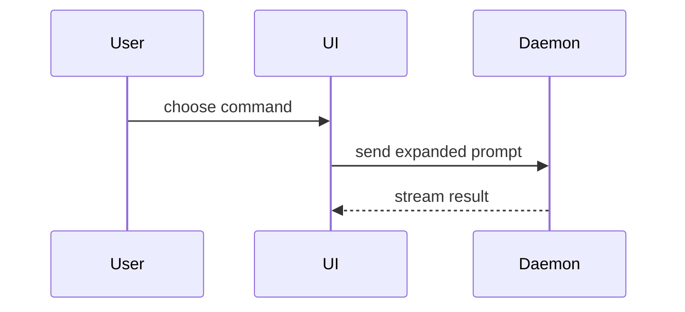

Reach for this skill whenever the user asks you to explain something, even if they don't ask for a visual. In T3 Code, make a focused HTML diagram the first choice. Respect any format the user explicitly requests.

## Lead with the diagram

1. Build one self-contained HTML diagram around the user's question. Use arrows for flow, a before-and-after view for changes, or a chart for a numerical trend. Use real labels and keep only the steps and relationships that explain the answer. Put detail beside the part it explains or reveal it on demand.
2. Make it easy to scan at thread width and on a phone. Use clear type, generous spacing, and color to carry meaning. Follow T3 Code's theme variables, leave the outer background transparent, and let the content set the height.
3. Pass the HTML or its absolute path to `html_preview`. Check that labels are legible and the layout fits, then pass the same HTML or path and the measured height to `html_render` to show it inline. Use the render tools directly without starting a server.
4. Keep the reply to the takeaway and any context the diagram needs. Put the explanation in the visual so the reader can follow it without a long block of chat text.

## Compact fallbacks

If inline HTML rendering is unavailable, pick the smallest inline visual that makes the point clear. These sketches can also supply labels or structure for the HTML diagram.

- Show logic or an algorithm as pseudocode:

```text
on(save)
  if content is unchanged
    return cached result
  write new content
  return fresh result
```

- Show runtime control flow as a call tree:

```text
submitForm
  createSession
    persistPrompt
    launchAgent
  navigateToSession
```

- Show UI structure as a component tree, including state and module boundaries that matter:

```tsx
<SessionPage> (apps/example/src/routes/session.tsx)
  useSessionEvents()
  <SessionToolbar>
    <RunSkillButton> (packages/ui)
```

- Show file responsibility or a broad refactor as a shallow file tree:

```text
src/
├── commands/       # parses user actions
├── sessions/       # owns session state
└── transport/      # sends API requests
```

- Show component interaction, control flow, or data flow with Mermaid:



- Use `diff` when the point is what changes and the surrounding shape already exists. Match the diff shape to the topic.

For a component change:

```diff
 <SessionPage>
   useSessionEvents()
   <SessionToolbar>
+    <RunSkillButton />
   <SessionTimeline>
+    <SkillResultCard />
```

For a file-layout change:

```diff
 src/
 ├── commands/
+│   └── show-me.ts       # expands the slash command
 ├── sessions/
-└── transport.ts
+└── transport/
+    ├── client.ts
+    └── stream.ts
```

For a call-tree or call-stack change:

```diff
 submitForm
   createSession
     persistPrompt
+    expandSkillMention
     launchAgent
-  navigateToSession
+  navigateToSession
+    subscribeToEvents
```

For a state or control-flow change:

```diff
 on(save)
-  write content
+  if content is unchanged
+    return cached result
+  write new content
+  invalidate cache
```

- Show the whole block when most of it is new, when omitted context would hide ownership or order, or when the user needs a copyable target shape:

```ts
function expandSkill(command: string): string {
  const skillName = command.slice(1)
  return `use the ${skillName} skill`
}
```

- Place each visual next to the short text it supports. Keep only the calls, files, props, states, and boundaries needed to answer the user's current question.
